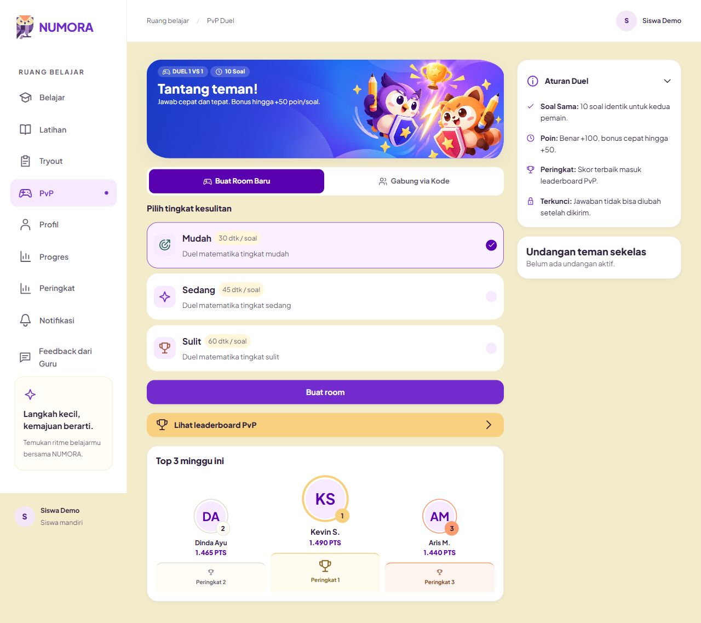
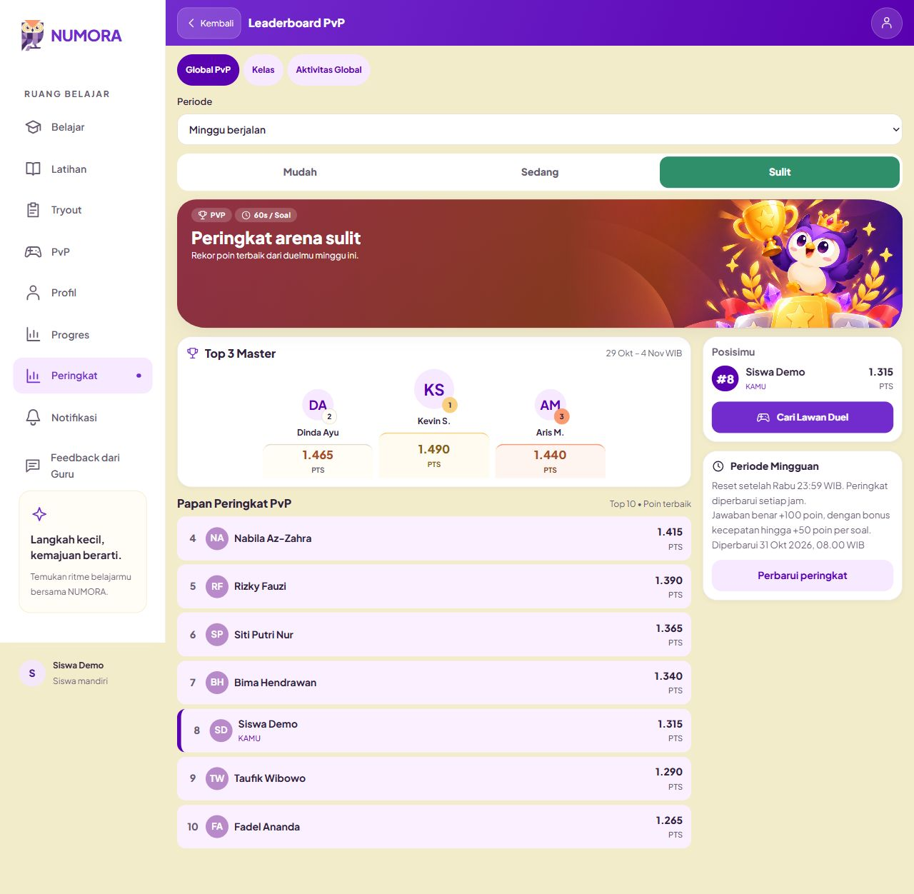

# Bukti audit kepadatan hero — 31 Oktober 2026

Screenshot Product Design dari preview localhost dengan fixture sintetis. Semua diambil pada sesi audit kepadatan ini, disimpan dan diinspeksi. Tidak mengandung akun nyata. Screenshot halaman penuh mempertahankan navigasi bawah fixed di posisi viewport saat capture.

[Laporan dan saran](../../STUDENT_HERO_DENSITY_AUDIT_2026-10-31.md). Saran adalah **PROPOSED**, belum diterapkan.

## 1. Mudah 390px — paling seimbang

[Halaman penuh](01-easy-390-page.png). Ruang teks tenang; podium dekoratif mengulang podium data.

## 2. Sedang 390px — cukup ramai

[Halaman penuh](02-medium-390-page.png). Sorot trofi/mahkota dominan; tab aktif masih hijau.

## 3. Sulit 390px — paling ramai

[Halaman penuh](03-hard-390-page.png). Cahaya, permata, pita dan podium bersaing; baris data lavender menambah kepadatan warna.

## 4. PvP 390px — aksi jelas, gambar dekat teks

[Halaman penuh](04-pvp-390-page.png). Tombol Buat room masih terlihat di viewport 390×844.

## 5. PvP 320px — keterbacaan perlu diperbaiki

[Halaman penuh](05-pvp-320-page.png). Pensil/karakter bersinggungan dengan judul dan deskripsi.

## 6. PvP desktop 1280px — baik

[Detail hero](06-pvp-1280-hero.png). Teks dan gambar terpisah dengan baik.

## 7. Sulit desktop 1280px — teks baik, warna halaman ramai

[Detail hero](07-hard-1280-hero.png). Hero tidak terlalu tinggi; penyederhanaan permukaan data akan memperjelas hierarki.
