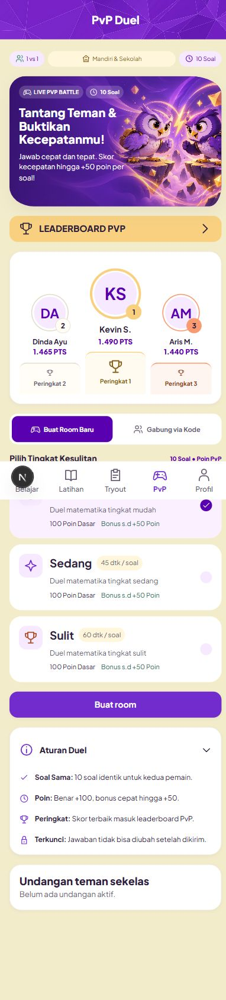
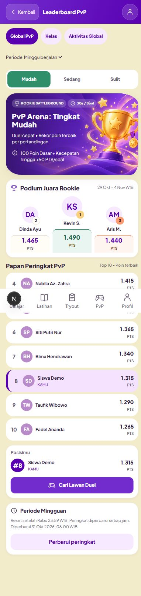
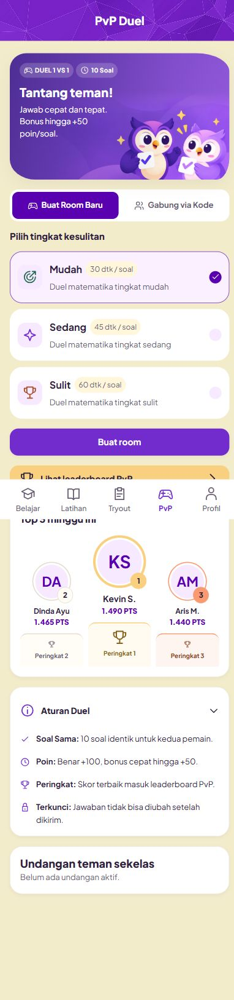
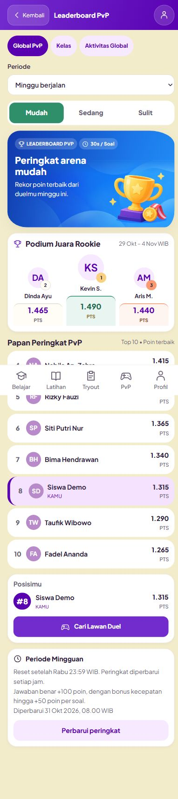

# Audit mobile PvP dan Leaderboard — galeri

Screenshot berasal dari browser in-app pada sesi 31 Oktober 2026, memakai fixture sintetis lokal. Tidak merekam akun atau data siswa nyata. Lihat [temuan, perbaikan dan batas audit](../../STUDENT_PVP_MOBILE_AUDIT_2026-10-31.md).

## 1. Sebelum perbaikan, 390px

| PvP                                             | Leaderboard                                                     |
| ----------------------------------------------- | --------------------------------------------------------------- |
|  |  |

Temuan: artwork dramatis/glow, teks bersinggungan dengan karakter, podium mendahului aksi utama, tipografi/filter kecil.

## 2. Hasil akhir, 390px

| PvP                                            | Leaderboard                                                    |
| ---------------------------------------------- | -------------------------------------------------------------- |
|  |  |

Ilustrasi mengikuti referensi Home; teks tetap HTML. CTA bermain didahulukan, kartu diringkas, filter dan nama diperbesar.

## 3. Batas minimum, 320px

- [PvP](05-pvp-320.png): tab utuh dan tidak overflow.
- [Gabung](06-join-320.png): input penuh dan tombol di baris berikutnya; screenshot menunjukkan focus ring keyboard.
- [Ruang tunggu](07-waiting-320.png): kode satu baris, QR dan tombol Siap.
- [Leaderboard Mudah](08-leaderboard-320.png), [Sedang](09-leaderboard-medium-320.png), [Sulit](10-leaderboard-hard-320.png): label/durasi dan layout diperiksa.
- [Aktivitas Global](11-activity-320.png): XP desimal tetap utuh dan angka podium tidak bertabrakan.
- [Kosong](12-leaderboard-empty-320.png), [gagal muat](13-leaderboard-error-320.png): state terbaca; retry berhasil memulihkan data. Screenshot error menampilkan skip-link yang sedang mendapat fokus.

## 4. Mobile lebar dan desktop

- [PvP 430px](14-pvp-430.png), [Leaderboard 430px](17-leaderboard-430.png).
- [PvP 1280px](15-pvp-1280.png), [Leaderboard 1280px](16-leaderboard-1280.png).

Ukuran adalah override viewport CSS. Screenshot dapat mengecualikan gutter scrollbar. Navigasi bawah fixed tampak di tengah screenshot full-page karena cara capture; setiap bagian tetap dapat dicapai dengan scroll.
