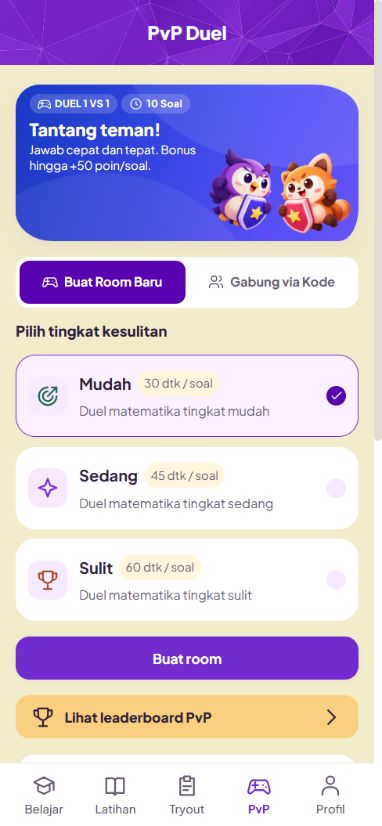
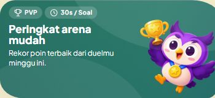
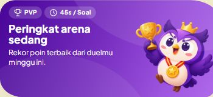
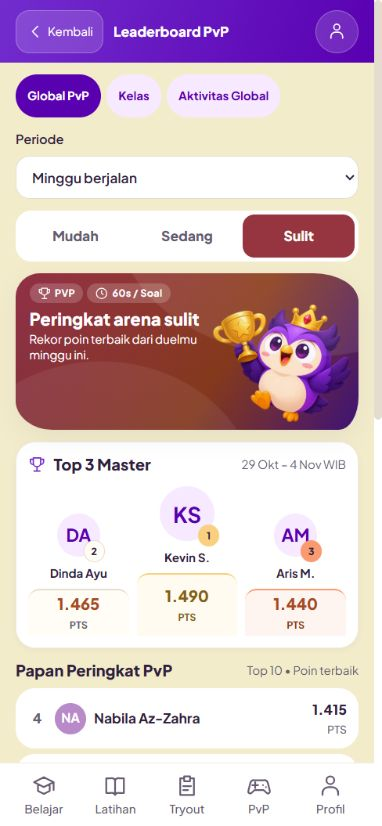

# Hero setelah perbaikan — 4 November 2026

Screenshot browser in-app, preview localhost dengan data sintetis. [Catatan implementasi](../../STUDENT_HERO_REFINEMENT_2026-11-04.md). `measurements.jsonl` memuat 16 kombinasi viewport/hero. Screenshot halaman panjang mempertahankan navigasi fixed pada posisi viewport saat capture.

## PvP — ruang teks terpisah

[320px](pvp-320-hero.png), [390px](pvp-390-hero.png), [768px](pvp-768-hero.png), [1280px](pvp-1280-page.png).

## Mudah — maskot, medali biru dan trofi

[320px](easy-320-hero.png), [768px](easy-768-hero.png), [1280px](easy-1280-page.png).

## Sedang — mahkota sederhana dan medali merah

[320px](medium-320-hero.png), [768px](medium-768-hero.png), [1280px](medium-1280-hero.png).

## Sulit — ornamen ringkas dan daftar netral

[320px](hard-320-hero.png), [390px halaman penuh](hard-390-page.png), [768px](hard-768-hero.png), [1280px](hard-1280-page.png).
