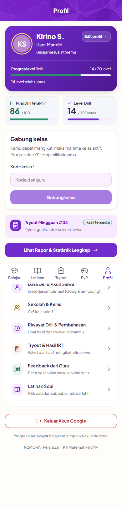
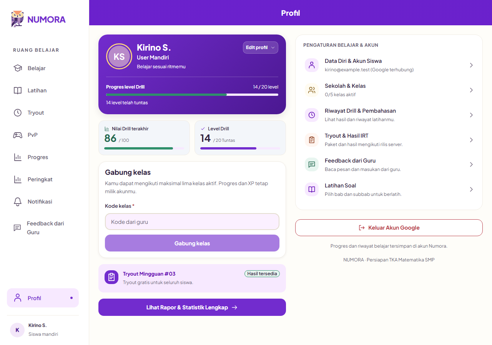

# Student profile — 10 November 2026

**ENGINEERING IMPLEMENTATION — owner-requested profile refinement.** Name and photo editing expands inside the identity card. The compact edit control sits at its upper right; below 360 px its visible label shortens to “Edit” while its accessible name remains “Edit profil”. The touch target remains 44 px. Redundant affiliation/status badges are removed. Class joining appears immediately after the Drill statistics, with join feedback nearby.

The images below use synthetic browser fixtures, including synthetic identity and class data. They contain no real Student information. The existing account browser scenarios passed at 390 and 1280 px, including feedback read acknowledgement and affiliation changes. Five membership browser regressions and fifteen account/editor unit tests also passed. These fixture checks do not represent integrated API/database acceptance; the connected release chain remains a separate CI check.

[Mobile geometry](profile-390.json) · [Desktop geometry](profile-1280.json)

