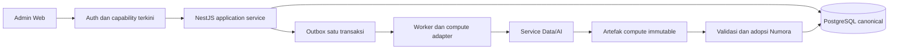

# Spesifikasi Teknis Admin Numora

Versi 1.0 · 10 November 2026 · acuan implementasi untuk [PRD Admin](../product/ADMIN_PRD.md).

Dokumen ini memetakan kebutuhan ke kode, kontrak dan model existing, kemudian menjelaskan perubahan yang diperlukan. Pembacaan working tree bukan bukti fitur sudah berjalan atau lulus QA. Tidak ada perubahan aplikasi, migrasi atau lingkungan dalam pekerjaan dokumentasi ini.

**ENGINEERING DECISION — ADM-DEC-076:** gunakan atribut/validator existing; detail rutin tidak memerlukan kuesioner baru. **ENGINEERING DECISION** di bawah merujuk keputusan pemilik, ADR atau fondasi yang sudah disahkan. Perluasan teknis yang belum mempunyai keputusan/kontrak diberi label **PROPOSED**. Ketergantungan produk/ilmiah hanya yang tercatat pada PRD §17.

## 1. Sumber dan batas arsitektur

| Sumber | Penggunaan |
| --- | --- |
| [PRD Admin](../product/ADMIN_PRD.md), [keputusan discovery](../product/ADMIN_REQUIREMENTS_DISCOVERY.md#21-keputusan-kebutuhan-dari-klarifikasi-pemilik) | Perilaku dan acceptance ADM-AC |
| [Product Context](../product/PRODUCT_CONTEXT.md), [Open Decisions](../product/OPEN_DECISIONS.md) | Amendemen dan dependensi lintas modul |
| [Varian/IRT v2](../AI_IRT_V2_CONTEXT.md), [kontrak kalibrasi v1](../IRT_CALIBRATION_CONTRACT_V1.md) | Assignment, delivery, evidence, kalibrasi dan hasil Tryout |
| [Pretest original](../development/PRETEST_ORIGINAL_RELEASE_2026-11-09.md) | Policy parsial, placement dan kompatibilitas legacy |
| [ADR-008](../adr/ADR-008-question-versioning.md), [ADR-011](../adr/ADR-011-separated-irt-compute.md) | Versi immutable dan pemisahan compute |
| [OpenAPI](../../packages/contracts/openapi/openapi.json) | Bentuk endpoint/DTO yang benar-benar tersedia |
| [Matriks izin](../api/ADMIN_PERMISSION_MATRIX.md), [struktur proyek](../development/PROJECT_STRUCTURE.md) | Capability, pembatasan identitas dan penempatan kode |

**ENGINEERING DECISION — arsitektur existing:** browser mengakses data bisnis melalui NestJS `/api/v1`. Supabase browser hanya untuk kebutuhan autentikasi; tidak membaca tabel bisnis langsung. NestJS berwenang atas izin, lifecycle, distribusi, penilaian, progres dan XP. PostgreSQL menyimpan fakta durable; Redis untuk cache/queue/lease sementara. Restart Redis tidak boleh menghapus draft, assignment, attempt atau hasil.

Gunakan UUID untuk ID eksternal, JSON camelCase, database snake_case dan TypeScript strict. Simpan timestamp UTC; jadwal bisnis serta penyajian waktu memakai Asia/Jakarta. Gunakan generated/shared contract types; error memakai `application/problem+json`. Perubahan schema memerlukan migrasi maju pada stream Numora, termasuk namespace compute. Jangan mengedit migrasi yang sudah diterapkan.

Diagram menunjukkan batas ownership, bukan jaminan seluruh jalur kalibrasi/publikasi telah terintegrasi. Cache hanya menyimpan proyeksi yang dapat dibangun ulang.

## 2. Penempatan kode dan otorisasi

| Area | Lokasi existing | Tanggung jawab |
| --- | --- | --- |
| Route dan halaman | `apps/web/src/app/admin/` | Komposisi layar, route guard presentasi |
| Fitur Admin | `apps/web/src/features/admin/` | Navigasi, form, model UI, pemanggilan API |
| Akun, pembaca operasional, Dashboard | `apps/api/src/modules/admin/` | Use case Admin, aggregate reader, audit projection |
| Sekolah/token | `apps/api/src/modules/schools/` | Status sekolah dan penerbitan/verifikasi credential |
| Konten/paket/upload/media/generator | `apps/api/src/modules/content/` | Validasi konten, revisi, approval dan publikasi canonical |
| Attempt/batch | `apps/api/src/modules/assessments/` | Start/resume/submit, pin paket dan aturan kesempatan |
| IRT | `apps/api/src/modules/irt/` | Snapshot, orchestration, validasi artefak/adopsi |
| Identity | `apps/api/src/modules/identity/` | Assignment/current status dan capability |
| Kontrak/data | `packages/contracts/`, `packages/database/` | Shared types/OpenAPI, schema dan migrasi |

Controller memvalidasi boundary dan mendelegasikan use case. Aturan bisnis tidak ditaruh di React atau controller kompleks. Layanan Admin tidak mengambil alih domain class/assessment/scoring.

Capability canonical berada pada [admin-capabilities.ts](../../apps/api/src/modules/identity/admin-capabilities.ts):

| Capability | Super | Operations | Content |
| --- | --- | --- | --- |
| ADMIN_ACCOUNTS_MANAGE | Ya | Tidak | Tidak |
| OPERATIONS_MANAGE | Ya | Ya | Tidak |
| OPERATIONS_LIMITED_READ | Ya | Ya | Ya |
| CONTENT_MANAGE | Ya | Tidak | Ya |
| ANALYTICS_OPERATIONS | Ya | Ya | Tidak |
| ANALYTICS_CONTENT | Ya | Tidak | Ya |
| AUDIT_READ | Ya, seluruh domain sah | Ya, operasional | Ya, konten/moderasi/IRT |

**ENGINEERING DECISION:** periksa assignment/status database pada setiap privileged request, bukan hanya klaim token atau menu. Subrole null/nonaktif ditolak. Content limited reader tidak mengembalikan identitas Student/Teacher, roster, join code, consumer token atau jawaban. Audit Content menyamarkan aktor non-Admin termasuk jalur filter; tidak cukup menyembunyikan kolom di browser. Semua role ditolak untuk ban/unban kelas.

## 3. Peta layar dan navigasi

Route berikut sudah terdapat dalam navigasi/fitur; kolom target menjelaskan perubahan perilakunya, bukan klaim semua target sudah diterapkan.

| Route existing | Target dan izin |
| --- | --- |
| `/admin`, `/admin/analytics` | Pintu masuk semua assignment aktif ke Dashboard scoped; tidak membuat Ringkasan kedua |
| `/admin/schools` | Operations/Super: sekolah, status, token dan histori |
| `/admin/operations?view=users` | Operations/Super: daftar/detail pengguna dan membership |
| `/admin/operations?view=classes` | Operations/Super: daftar/detail kelas dan roster baca saja |
| `/admin/structures` | Struktur/count terbatas untuk Content; tanpa mutasi atau PII |
| `/admin/content?view=curriculum` | Content/Super: master dan ringkasan kesiapan |
| `/admin/content?view=questions` | Katalog global baca saja; tautan menuju konteks authoring |
| `/admin/content?view=videos` | Content/Super: video manual, urutan otomatis |
| `/admin/content?view=reports` | Content/Super: kasus dan laporan terkait |
| `/admin/content?view=verification` | Gate/review existing; tidak menjadi pintu tambah soal umum |
| `/admin/content?view=audit` | Histori terfilter sesuai domain |
| `/admin/assessments/pretest` | Daftar bab/slot, aksi Atur Pretest; bukan pembuatan paket bebas |
| `/admin/assessments/drill` | Pilih bab/subbab/level, lalu original/varian/revisi |
| `/admin/assessments/tryout` | Master paket serta akses pengelolaan batch yang terpisah secara fungsi |
| `/admin/irt?view=batches`, `?view=requests` | Batch health/request, deadline, kegagalan dan aksi yang sah |
| `/admin/accounts?view=accounts`, `?view=invitations` | Super: akun dan undangan |

Detail asesmen memakai helper route existing `/:id`. Route legacy/root import tidak menjadi menu input umum; arahkan pengguna ke tujuan yang sah. Jangan menyediakan dua penyimpanan paket untuk route lama dan baru. URL final untuk layar batch terpisah merupakan pilihan implementasi **PROPOSED**; tidak perlu membuat route fiktif sebagai kontrak existing.

**ENGINEERING DECISION — ADM-DEC-073/074/075:** simpan search/filter/offset atau page dalam URL mengikuti pola existing; tombol kembali memulihkan konteks. Lanjutkan draft dari record terakhir yang sukses disimpan server. Laptop utama, seluruh fungsi dapat diakses di ponsel. Gunakan baseline komponen/desain existing; loading/error/empty/forbidden, label/fokus keyboard dan aksi penting tetap tersedia. Status proses dan Dashboard menggantikan kebutuhan pusat notifikasi baru.

## 4. Atribut dan validasi baseline

Tabel berikut mengunci keputusan rutin pada DTO/kontrak existing. Ketika DTO lebih rinci, validator DTO tetap menjadi sumber teknis; jangan membuat form schema yang bertentangan. Perluasan reader untuk kebutuhan yang telah disepakati dicatat pada §13.

| Objek | Representasi existing dan aturan |
| --- | --- |
| Sekolah | `code` 2–32 alfanumerik/hyphen, unik sesuai normalisasi service; `name` nonblank 1–120; `address` opsional ≤500. PATCH existing mengubah name/address/status, bukan code. |
| Bab/subbab | `code` pola `[A-Za-z0-9-]{1,64}`, `name` ≤160, `description` opsional ≤2000, `displayOrder` 1–100000; induk bab wajib untuk subbab. Slug/kategori existing tetap sesuai DTO. |
| Indikator/competency | `subchapterId`, `code`, `description` wajib dan status existing. Tidak ada field create `name` atau `displayOrder` terpisah; representasi ini memenuhi arahan atribut terakhir. |
| Level | `subchapterId`, `levelNumber` 1–5; deskripsi/status existing. Lima slot dibuat otomatis; pengguna tidak menambah Level 6. |
| Paket | `familyCode`, `packageVersion`, `name`, `assessmentType`, scope chapter/level, `source`, flag demo existing. Detail mencakup readiness, approval, scoring policy, availability dan distribution. |
| Isi paket | `expectedRevision`, `name`, daftar `questionVersionIds` unik. Kapasitas intake DTO tidak mengganti syarat efektif 20/10/30. |
| Soal | Struktur PG/MCMA/Category, isi/LaTeX, options/statements, answer key, explanation, media, mapping dan difficulty mengikuti kontrak question/import existing. READY perlu metadata/kesulitan/kunci/pembahasan yang sah. |
| Video | `title` nonblank ≤240, HTTPS YouTube `url` ≤2000, `source` ≤160, `subchapterId`, `recommendationOrder` 1–100000, status existing. Tidak ada field deskripsi baru yang wajib ditambah. |
| Laporan | Status OPEN/IN_REVIEW/RESOLVED/REJECTED, `followUp` wajib untuk aksi penyelesaian existing, `revisionQuestionVersionId` bila ada revisi. UI memakai label Baru/Ditinjau/Selesai/Ditolak. |
| Undangan Admin | Nama, email dan satu adminRole wajib, normalisasi/validator identity existing; status akun/assignment/undangan/pengiriman dipisah. |
| Pagination konten | `offset` default 0, `limit` default 20/maksimum 100 pada pembaca yang memakai ContentPageDto. Endpoint lain mengikuti DTO masing-masing. |
| Media | PNG/JPEG/WebP, ukuran 1–5.242.880 byte, SHA-256, identitas externalId/assetId/contentVersion sesuai DTO. Bukan 5.000.000 byte. |
| Intake | JSON existing maksimum 100 item/body 2 MiB; Excel maksimum 10 MiB. Ini kapasitas parsing, bukan jumlah soal yang diizinkan untuk aktivasi. |

Referensi: [content.dto.ts](../../apps/api/src/modules/content/content.dto.ts), [content-packages.dto.ts](../../apps/api/src/modules/content/content-packages.dto.ts), [media-uploads.dto.ts](../../apps/api/src/modules/content/media-uploads.dto.ts), dan OpenAPI.

**PROPOSED — penyesuaian teknis tanpa field produk baru:** sistem mengisi `source` video dengan sumber YouTube dan menetapkan `recommendationOrder` monoton sesuai penambahan di subbab. Pembaruan judul/URL tidak mengurutkan ulang video. Gunakan kolom existing dan transaksi untuk alokasi urutan. Tidak meminta Admin mengisi angka urutan. Identitas video dinormalisasi berdasarkan ID YouTube agar URL berbeda tidak memintas satu video/satu subbab; audit data lama sebelum menambah constraint.

## 5. Model durable dan invariants

| Domain | Schema existing | Invariant target |
| --- | --- | --- |
| Taksonomi/soal/video | [content.ts](../../packages/database/src/schema/content.ts) | Parent sah; arsip tidak memutus paket aktif; versi soal historis immutable |
| Paket/attempt/progres | [assessments.ts](../../packages/database/src/schema/assessments.ts) | Package items berversi; attempt memin isi dan policy; tidak recalculation histori |
| Arm/alokasi/delivery | [assessment-arms.ts](../../packages/database/src/schema/assessment-arms.ts) | Assignment persisten, delivery aktual terpisah, unique attempt/batch sesuai v2 |
| Upload progres | [content-uploads.ts](../../packages/database/src/schema/content-uploads.ts) | Owner/tujuan/revisi/idempotency/sumber durable; progres bukan publikasi |
| Preview/impor | [content-preview.ts](../../packages/database/src/schema/content-preview.ts) | Identity/provenance dan versi dipertahankan; preview bukan attempt siswa |
| Media | [content-media.ts](../../packages/database/src/schema/content-media.ts) | Hanya VERIFIED dapat ditautkan; file historis tidak ditimpa |
| Sekolah/akun Guru | [identity.ts](../../packages/database/src/schema/identity.ts) | Status sekolah terpisah dari akun/verifikasi; credential single-use |
| Kelas/membership | [classes.ts](../../packages/database/src/schema/classes.ts) | Riwayat join/leave/ban terjaga; nonaktif sekolah tidak mengakhiri membership |
| Akun Admin | [admin-accounts.ts](../../packages/database/src/schema/admin-accounts.ts) | Invitation/recovery lifecycle dan assignment terkini; Super terakhir terlindungi |
| Laporan | [support.ts](../../packages/database/src/schema/support.ts) | Laporan sumber dipertahankan; kasus soal/versi serta transisi dapat ditelusuri |
| Audit/outbox | [operations.ts](../../packages/database/src/schema/operations.ts) | Audit aman, outbox satu transaksi; consumer idempotent |

Fondasi v2 sudah mempunyai distribution policies, arm sets/arms/revisions, batch-package links, assignments dan delivery/events. Keberadaan schema/migrasi 0051 dan generator 0052 tidak berarti seluruh UI/distribusi/rilis telah selesai. Jangan menyebut semua schema arm belum ada atau membuat tabel paralel tanpa menilai fondasi tersebut.

**PROPOSED — mapping tambahan:** gunakan identitas chapter sebagai slot Pretest dan unique subchapter/levelNumber sebagai slot Drill; slot kosong tidak memerlukan paket palsu. Persistensi pilihan anchor harus menyimpan identitas proses, source package revision dan source question-version IDs, lalu output variant ID. Gunakan model lineage existing sejauh cocok; perubahan yang belum terwakili memerlukan kontrak/migrasi maju, bukan flag anchor global pada question.

Revisi paket, versi soal, versi scoring policy, arm revision, input snapshot dan artefak compute adalah pin berbeda. Nomor revisi draft untuk konkurensi bukan versi akademik dan bukan status PASS IRT.

## 6. State dan transisi

| Objek | State existing/target | Ketentuan |
| --- | --- | --- |
| Konten | DRAFT / READY / REVISION / ARCHIVED | READY editorial tidak otomatis berarti distribusi atau hasil IRT sah |
| Paket | DRAFT / PUBLISHED / CLOSED / ARCHIVED pada kontrak existing | UI Simpan mengorkestrasi gate, tidak mengganti enum sembarangan |
| Upload progres | RECEIVED / INVALID / PREVIEW / VALIDATED / SAVED | INVALID tetap dapat menyimpan progres; SAVED tidak otomatis PUBLISHED |
| Media | PENDING → VERIFIED | Gagal/expired tetap terlihat; complete memeriksa file sebelum VERIFIED |
| Kasus laporan | OPEN → IN_REVIEW → RESOLVED/REJECTED; laporan baru soal dan versi sama → OPEN | Histori penutupan tetap; tidak wajib assignment |
| Undangan | RESERVED / SENDING / INVITED / FAILED / ACCEPTED / CANCELLED | Provider sukses tidak menjadi bukti delivery; accepted dikelola sebagai akun |
| Recovery | RESERVED / SENDING / SENT / FAILED | Tidak memuat credential pada audit |
| Pengukuran/perbandingan/distribusi v2 | UNCALIBRATED/CALIBRATED/INSUFFICIENT/ANOMALY; PENDING/PASS/DRIFT/NOT_COMPARABLE; PROVISIONAL/READY/HOLD/INACTIVE | Dimensi konseptual terpisah, bukan perintah mengganti semua enum existing |

**PROPOSED — orkestrasi Simpan:** UI tetap satu tindakan Simpan untuk pemberlakuan revisi valid. Application service memvalidasi versi dasar, isi, metadata, media, blueprint/rubrik dan approval yang sah; membuat pin versi baru serta mengganti pointer effective dalam satu transaksi. Jika belum memenuhi gate, simpan progres/draft dan kembalikan status belum efektif beserta blocker. Jangan menghapus approval guard hanya agar label tombol tampak sesuai.

Approve/publish endpoint existing adalah primitive backend, bukan kewajiban dua tombol tambahan bagi pengguna. Pemisahan pembuat/pemeriksa masih ADM-DEP-05; jangan menganggap pengguna dapat menyetujui hasilnya sendiri. Edit yang mengubah isi mengharuskan bukti approval cocok dengan revisi baru; approval revisi lama tidak dipakai diam-diam.

## 7. Workflow per domain

### 7.1 Materi dan slot

1. Content/Super mengirim create/update melalui API master dengan parent yang sah.
2. Dalam transaksi create bab/subbab, sediakan slot logis Pretest atau lima level kosong; gunakan unique constraint untuk retry/concurrency.
3. Reader kesiapan menghitung draft versus versi efektif, jumlah valid, blocker dan tautan tujuan. Label bukan bukti persetujuan Curriculum.
4. Saat arsip, periksa dependency paket aktif dalam transaksi yang mencegah paket baru lolos bersamaan memakai materi yang diarsipkan. Bila masih dipakai, kembalikan conflict dengan daftar dependency yang aman dilihat.
5. Referensi historis tetap tersedia; tidak cascade-delete soal, attempt atau hasil.

### 7.2 Authoring, impor dan media

1. Muat tujuan serta `expectedRevision`; validasi izin/assessmentType/scope di server.
2. Gunakan upload session existing untuk sumber, checksum, hasil parsing, pemetaan, koreksi dan error baris. Append/replace adalah pilihan terhadap draft, bukan overwrite published items.
3. Autosave menggunakan optimistic concurrency; sukses mengembalikan revisi draft terbaru. Refresh membuka snapshot server yang sukses terakhir.
4. Tampilkan dugaan duplikat sebagai warning dengan baris/alasannya. Keputusan Admin dicatat pada preview sebelum penerapan. Kesamaan konten tidak otomatis menyamakan identity, family atau anchor.
5. Media: reserve → signed upload → complete/verify → tautkan receipt VERIFIED pada revisi. Kegagalan upload tidak membatalkan seluruh progres; validasi readiness menahan penggunaan media belum sah.
6. Terapkan intake ke draft secara idempotent setelah error yang menghalangi diperbaiki. Berikan preview jumlah sebelum/sesudah dan item yang dilepas pada replace.
   Kelebihan kapasitas tetap berada pada preview untuk diperbaiki; jangan memasukkan item berlebih ke isi paket dengan alasan masih draft.
7. Simpan menjalankan gate §6; jumlah 20/10/30 terpenuhi sebelum efektif. Attempt lama tetap memakai versi/media lama.

**PROPOSED — autosave:** gunakan debounce/pola form existing dan satu request berurutan per draft agar respons lambat tidak menimpa revisi terbaru. Jangan mengarang SLA interval. Tampilkan Sedang menyimpan/Tersimpan/Belum tersimpan/Gagal/Konflik. Flush sebelum perpindahan bila memungkinkan; browser unload bukan jaminan penyimpanan. Simpan eksplisit menunggu autosave in-flight dan memakai revision server terbaru. Jika koneksi putus, retry memakai operation key yang sama; draft tidak diakui durable sebelum respons sukses.

### 7.3 Mulai attempt dan revisi efektif

**ENGINEERING DECISION — ADR-008/keputusan pemilik:** paket efektif dipilih pada start server, bukan saat membuka daftar di browser. Start dan penggantian revisi harus menghasilkan satu urutan atomik: start menerima seluruh versi lama atau seluruh versi baru, tidak campuran.

**PROPOSED — transaksi:** lock identitas slot/paket atau gunakan serializable/CAS sesuai repository; periksa kesempatan/eligibility, pilih effective immutable revision, simpan attempt dan item/scoring pins lalu commit. Simpan revisi memakai koordinasi yang sama. Resume/submit membaca pins attempt tanpa memilih ulang paket. Finalization idempotent, XP ledger dan outbox tidak terduplikasi. Pretest sekali selesai/bab tidak direset oleh revisi.

Drill v2 memin assigned arm dan actual delivery; fallback original tidak menulis ulang assignment. Jangan menerapkan algoritma pemerataan discovery sebelum ADM-DEP-01 diselesaikan. Hentikan distribusi baru invalid/DRIFT menurut gate v2 sambil mempertahankan sesi/histori; ADM-DEP-02 membatasi klaim target keep-available.

### 7.4 Varian/generator

Pin source package revision → pilih tepat 3/5 source question versions → catat proses → panggil jalur existing yang sah → preview/validasi hasil → buktikan anchor identik dan focal sesuai kontrak → review/intake → satu varian hasil. Pilihan proses berikutnya boleh berbeda; relasi lama immutable.

Generator request retry untuk masalah transport memakai input/config/seed yang sama. Iterasi ilmiah karena DRIFT membuat config/input/item version baru. Output generate, preview, SEALED, CONTENT_VALID, PASS dan VALIDATED_FOR_REUSE bukan sinonim. Belum ada izin mengaktifkan hasil tanpa review. Detail integrasi anchor ke generator/impor baru bergantung ADM-DEP-03; jangan menambahkan alur final dari dugaan.

### 7.5 Batch Tryout dan rilis

**ENGINEERING DECISION — v2:** batch mempunyai daftar paket berversi frozen sebelum mulai; satu attempt/student/batch. Batas per-package lama tidak cukup. Start memeriksa batch aktif, alokasi sah dan constraint kesempatan dalam transaksi. Siswa tidak memperoleh attempt kedua dengan mengganti kelas/sekolah/paket di batch yang sama. Effective deadline tidak melewati close batch.

Alokasi per sekolah/kelas membutuhkan pembacaan membership dan policy versi saat assignment; precedence dan multisekolah menunggu ADM-DEP-03. Jangan mengasumsikan first match di frontend. Master Simpan setelah freeze tidak memperbarui batch-package pin. Gunakan schema arm/batch-package existing dan tolak penggantian in-place pada batch berjalan.

Penutupan batch → finalisasi sah → snapshot input respondent/attempt/package/batch dan versi policy → request compute/outbox → pantau/retry → validasi payload v1, input hash/identity/coverage → adopsi canonical → pilih mode IRT/fallback per arm → publikasi hasil/pembahasan batch bersama ≤72 jam. Output compute tidak langsung menulis nilai siswa atau XP.

Request sukses, artefak diadopsi, participant coverage lengkap dan hasil terbit ditampilkan sebagai keadaan berbeda. Mapping IRT memakai prediksi poin paket acuan yang frozen; angka numerik/estimator/gate ilmiah tidak diisi oleh Admin. Fallback poin valid/maks valid ×100 menggunakan policy yang dipin; maksimum nol → UNSCORABLE. Jangan mengubah error menjadi skor0 atau mempublikasikan sebagian siswa hanya untuk memenuhi timer. Penanganan teknis yang menghalangi coverage membutuhkan escalation yang sah sebelum deadline; kebijakan kompensasi/late correction tidak diciptakan di UI.

### 7.6 Laporan dan video

**PROPOSED — kasus laporan:** gunakan key unik soal-version untuk satu kasus dan kaitkan record laporan sumber secara transaksional. Saat laporan baru tiba, insert laporan + upsert kasus; bila terminal, ubah ke OPEN dan append transition record. Race reopen versus penutupan menggunakan row lock/revision guard agar laporan baru tidak hilang dalam penutupan lama. Reopen tidak menghapus followUp/riwayat sebelumnya.

Reader kasus menyajikan jumlah laporan sumber, status kasus, isi versi terkait, followUp dan tautan revisi tanpa PII pelapor. Closing memerlukan alasan; jika konten diperbaiki, revisi harus target sah. Perbaikan konten tidak otomatis menyelesaikan kasus. Laporan video memakai target/lifecycle existing; tidak otomatis mengikuti penggabungan soal-version.

**PROPOSED — video:** kunci konteks subbab saat aktivasi atau pemindahan mapping; hitung video aktif dalam transaksi yang sama dan tolak jika melebihi tiga. Normalisasi ID YouTube menjaga satu video/satu subbab. Urutan ditetapkan saat ditambahkan dan dipertahankan saat edit. Laporan tidak mengubah status video otomatis; perbaikan/penonaktifan dan penutupan kasus merupakan aksi tersendiri yang diaudit.

### 7.7 Sekolah, token dan histori Guru

Operations/Super create/update sekolah → server validasi status → terbitkan token tunggal/bulk → tampilkan credential hanya lewat response/flow penyerahan yang berwenang → bagikan offline. Credential disimpan hash sejauh flow existing mendukung; jangan mencatat plaintext dalam audit atau log.

Consume token menggunakan transaksi/conditional update yang memeriksa unused, expiry dan eligibility sekolah. Dua Guru tidak dapat berhasil memakai token sama. Reissue membuat token baru tanpa otomatis revoke sumber unused; expiry sumber tidak diperpanjang. Revoke eksplisit tetap tersedia. **PROPOSED:** bulk mempunyai operation key dan hasil per item; retry tidak menerbitkan tambahan tersembunyi. Batas teknis bulk mengikuti service/kontrak yang ditetapkan engineering, bukan angka produk baru.

Penonaktifan sekolah mempertahankan membership aktif dan batas lima. Guard kelas menolak join/create/takeover/feedback baru, bukan hanya menyembunyikan tombol. Siswa tetap dapat belajar melalui hak akun; status sekolah tidak menjadi paywall demo.

**PROPOSED — histori akses:** simpan transisi status sekolah dan waktu efektif secara durable agar reaktivasi tidak menghapus cutoff lama. Untuk sekolah nonaktif, reader Guru memeriksa kewenangan historis dan `attempt.completedAt < deactivatedAt`; IRT release setelah cutoff tetap dapat memperkaya hasil attempt lama. Gunakan instant UTC yang sama di seluruh reader; equality bukan "sebelum". Reader aggregate tidak boleh memasukkan aktivitas baru lewat join hasil terlambat. Hak pada perubahan owner/periode nonaktif berulang di luar kasus yang disepakati tetap ADM-DEP-06, bukan izin memperluas akses.

Reaktivasi memulihkan guard/monitoring otomatis untuk relasi masih sah tanpa menghidupkan kembali ownership/membership yang sudah berakhir. Rekam histori transisi; tidak menulis ulang timestamp/progres siswa.

### 7.8 Pengguna, akun Admin dan audit

Pembaca operasional menggabungkan akun, verifikasi dan daftar afiliasi; tidak menggandakan pengguna ketika join banyak membership. Detail memisahkan current membership dari riwayat. Tidak ada endpoint mutasi membership/ownership Admin yang ditambahkan. Ban/unban tetap domain Teacher aktif.

Akun Admin memakai lifecycle undangan/recovery existing. Recheck status sebelum retry/cancel/accept; email akun Student/Teacher ditolak. Perubahan adminRole/status wajib alasan dan konfirmasi. **PROPOSED:** perluas DTO PATCH untuk alasan jika belum tersedia; sertakan audit dalam transaksi perubahan dan serialisasi guard jumlah Super aktif agar dua demosi bersamaan tidak menyisakan nol Super. Penyelesaian undangan ke akun harus konsisten/idempotent walau callback diulang.

Audit successful mutation mencatat actor/target/action/diff aman/reason/outcome dalam transaksi canonical. Untuk kegagalan yang rollback, catat event gagal melalui jalur durable terpisah tanpa mengklaim perubahan terjadi. Tidak log setiap ketikan autosave sebagai tindakan publikasi; catat checkpoint/aksi penting yang diperlukan penelusuran. Masking diterapkan pada query/projection dan filter. Retensi mengikuti existing; tidak membuat kebijakan hapus otomatis dari dokumen ini.

## 8. API existing dan perubahan kontrak

Semua path di tabel berawalan `/api/v1`. Ini inventaris OpenAPI pada saat penyusunan, bukan endpoint baru yang dijanjikan. Gunakan response/operation type generated. Endpoint legacy yang co-exist tidak menjadi sumber data tandingan.

| Domain | Endpoint existing | Kebutuhan penyesuaian |
| --- | --- | --- |
| Dashboard | GET `/admin/analytics`; reader lama `/admin/dashboard` | Scoped data tetap; filter/periode comparison dan metadata metric perlu reader/DTO yang mendukung |
| Sekolah | GET/POST `/admin/schools`, GET/PATCH `/admin/schools/{schoolId}` | Cutoff/history dan dampak read-only lintas domain |
| Token | GET/POST `/admin/schools/{schoolId}/teacher-tokens`, POST `.../{tokenId}/reissue`, `.../{tokenId}/revoke` | Bulk bila belum didukung; ubah reissue tanpa revoke otomatis |
| Pengguna | GET `/admin/users`, `/{userId}`, `/{userId}/memberships` | Lengkapi list email/verifikasi/afiliasi dan histori sesuai kebutuhan |
| Kelas | GET `/admin/classes`, `/{classId}`, `/{classId}/roster` | Reader status sekolah/Guru/aktif-mantan; tanpa mutasi membership |
| Struktur terbatas | GET `/admin/structures/schools`, `/admin/structures/classes` | Pertahankan field aman Content, bukan reuse DTO PII |
| Akun | GET `/admin/accounts`, GET/PATCH `/{id}`, POST `/{id}/recovery` | Alasan/konfirmasi perubahan dan guard Super terakhir |
| Undangan | GET/POST `/admin/invitations`, POST `/{id}/retry`, `/{id}/cancel`; GET `/admin/invitation/status`, POST `/admin/invitation/accept` | Status delivery jujur, email conflict, retry/cancel sesuai state |
| Master | GET `/admin/content/curriculum`; POST `/admin/content/chapters`, `/subchapters`, `/competencies`, `/levels`; PATCH masing-masing `/{id}` | Slot otomatis dan active-dependency archive guard |
| Soal | GET `/admin/content/versions`, `/{id}`; POST `/admin/content/questions`, `/admin/content/versions/{id}/revisions`; PATCH `.../{id}/status`; POST `.../{id}/review` | Authoring kontekstual enforced server; global reader provenance/report/IRT |
| Paket | GET/POST `/admin/content/packages`, GET/PATCH `/{id}`; POST `/{id}/intake`, `/approval`, `/publish`, `/archive` | Orkestrasi Simpan, slot/readiness dan immutable effective revision |
| Intake JSON | POST `/admin/content/import-validations`, `/admin/content/imports`; GET `/admin/content/imports/{id}` | Tujuan tetap, append/replace, duplicate warning/decision |
| Excel | POST `/admin/content/excel-parses`, GET `/admin/content/excel-template` | Satu paket/file, repair progres; template existing |
| Upload durable | GET/POST `/admin/content/uploads`, GET `/{id}`, PATCH `/{id}/preview`, POST `/{id}/draft`; GET `/admin/content/upload-template` | Autosave progres, concurrency, resume dan konteks tujuan |
| Media | POST `/admin/content/media/uploads`, POST `/{uploadId}/complete` | VERIFIED gate, alt text dan immutable linkage |
| Video | GET/POST `/admin/content/videos`, PATCH `/{id}` | Urutan otomatis, identitas video, max3 aktif, satu subbab |
| Laporan | GET `/admin/reports`, GET/PATCH `/admin/reports/{kind}/{id}` | Case grouping/reopen dan histori, bukan hilangkan laporan sumber |
| Audit | GET `/admin/audit-logs` | Diff/reason/outcome/filter sesuai domain; tanpa export |
| IRT | GET `/admin/irt/options`, `/batch-health`, `/batches`; GET/POST `/admin/irt/requests`, GET `/{id}`, POST `/{id}/retry`, `/{id}/adopt` | Health/coverage/release terpisah; adapter/adopter/publication masih dituntaskan |
| Generator request | GET `/admin/content/generator/catalog`; GET/POST `/requests`, GET `/requests/{id}`, POST `.../retry`, GET `.../preview`, POST `.../draft` di prefix generator | Pin source/anchor dan konteks; jalur final menunggu ADM-DEP-03 |
| Generator package | GET/POST `/admin/content/generator/packages`, GET `/packages/catalog`, GET `/packages/{id}`, GET `.../file`, POST `.../retry`, `.../validate-json`, `.../import-json` | Hasil tidak otomatis akademik/terbit; pertahankan lineage |

Beberapa prefix singkat pada tabel menunjuk resource yang sama, bukan path top-level `/subchapters` atau `/requests`. Lihat OpenAPI untuk path lengkap dan payload. Endpoint legacy pretest/drill/tryout-packages masih co-exist; canonical package service menjadi dasar orkestrasi. API authoring batch multipaket dan final publication tidak boleh dianggap selesai hanya karena endpoint IRT health atau Tryout legacy publish tersedia.

**PROPOSED — evolusi kontrak:** perpanjang primitive/application service canonical bila perlu untuk atomic Save, batch management, anchor process dan report cases. Definisikan operation ID, body/request revision, outcome/draft-effective status, blockers serta idempotency semantics di OpenAPI sebelum client memakai. Nama endpoint baru tidak dibekukan oleh spesifikasi ini dan tidak memerlukan keputusan pemilik atas atribut rutin.

## 9. Transaksi, konkurensi dan idempotensi

| Operasi | Perlindungan yang diperlukan |
| --- | --- |
| Autosave/ubah draft/Simpan | Compare-and-swap `expectedRevision`; no silent last-write-wins; serialisasi autosave client |
| Aktivasi revisi dan start attempt | Satu urutan atomik pada slot/effective pointer; snapshot seluruh item/policy konsisten |
| Impor/retry/media completion | Operation key + hash sumber; replay operasi sama tidak menggandakan hasil; payload berbeda pada key sama ditolak |
| Slot otomatis | Unique bab-slot dan subbab/level; create slot bersama master dalam transaksi |
| Arsip master | Dependency check dan koordinasi dengan publikasi paket; tidak hanya preflight UI |
| Laporan bersamaan/reopen | Unique case per question-version, lock/CAS transisi dan append original reports |
| Aktifkan video | Kunci per subbab dan check kapasitas dalam transaksi; urutan diserialisasi |
| Consume/reissue/bulk token | Conditional consume, expiry/status sekolah diperiksa; operasi penerbitan idempotent |
| Ubah role/status Super | Guard jumlah Super aktif di transaksi terkoordinasi; alasan/audit atomic |
| Start Tryout | Constraint student/batch, assignment durable, package pin frozen |
| Submit/XP/rilis | Finalization dan ledger source unik; hasil final immutable; outbox atomic |
| Compute/adopt/retry | Input/artefak pinned, lease fencing, idempotent adoption, validasi identity/coverage |

**PROPOSED — pemulihan konflik:** server mengembalikan conflict beserta identitas/revisi terbaru yang aman. Client mempertahankan buffer edit terotorisasi, menampilkan perubahan sudah kedaluwarsa dan memuat versi terbaru sebelum penerapan ulang manual. Tidak auto-merge kunci, anchor atau isi paket. Saat izin hilang, hentikan penyimpanan, bersihkan cache sensitif role sebelumnya dan lanjutkan draft hanya setelah autentikasi/otorisasi sah; tidak menyimpan credential di local storage.

## 10. Error dan status proses

Gunakan format problem+json existing dan kode problem domain stabil yang sudah tersedia. Pemetaan berikut adalah **PROPOSED** untuk perluasan yang belum mempunyai kontrak; jangan mengganti status endpoint existing tanpa compatibility review.

| Kondisi | Respons/penyajian |
| --- | --- |
| Auth kedaluwarsa | 401; jalur login ulang existing, tidak terus retry mutasi |
| Role/lingkup tidak sah | 403; hilangkan data/aksi terlarang, tanpa bocoran objek |
| ID tidak ada/tidak dapat diakses menurut kebijakan existing | 404 atau respons authorization existing |
| Field/file/type invalid | 400/422 sesuai konvensi endpoint; pointer field/baris, pesan koreksi |
| File terlalu besar | 413 bila ditolak transport, atau problem validasi DTO existing |
| Revisi stale/dependency aktif/kapasitas terlampaui | 409; muat versi terbaru atau selesaikan dependency |
| Duplicate content warning | Warning preview, bukan HTTP failure wajib; keputusan Admin sebelum apply |
| Constraint identity/idempotency conflict | Conflict keras; keputusan duplikat konten tidak memintas constraint |
| Upload/compute/provider sementara gagal | Status gagal, reason aman, retry yang sah memakai operasi yang sama |
| Data aggregate/IRT tidak ada | Unavailable/reason, bukan0 atau sukses palsu |

Tampilkan keadaan awal loading, kosong, gagal awal, refresh gagal dengan data lama/stale, berhasil, forbidden dan conflict. Long-running job mengembalikan identitas proses dan dibaca lewat status existing; tidak menahan request browser sampai compute selesai. Hindari stack trace, token, payload secret dan PII tak perlu dalam problem detail/log.

## 11. Dashboard, waktu dan pekerjaan latar

**ENGINEERING DECISION — baseline metric:** gunakan definisi [Dashboard existing](../design/ADMIN_ANALYTICS_UX_2026-10-30.md#struktur-dashboard-dan-makna-data): `students` akun aktif, `classes` kelas belum arsip, `memberships` relasi aktif, `readyVersions` versi READY, completion berdasarkan attempt GRADED. Jangan mengubah angka akun aktif menjadi DAU/MAU atau penjumlahan completion+started. Coverage 0/0 bukan0%.

**PROPOSED — filter/perbandingan:** pertahankan snapshot kumulatif existing saat tanpa filter. Untuk tanggal gunakan rentang lokal yang dikonversi ke `[from,to)` UTC; attempt started memakai startedAt dan completed memakai completedAt. Comparison memakai periode sebelumnya dengan panjang sama; baseline0 menampilkan delta absolut dan persentase tidak tersedia. Jangan mengarang persentase tak hingga.

Count stock saat ini seperti siswa aktif atau sekolah diberi label snapshot waktu pengambilan; tidak menyatakan histori stock bila tidak tersedia. Bila snapshot historis belum ada, metrik itu tidak mendapat comparison palsu. School-filter attempt memerlukan atribusi durable/snapshot yang benar; bila sumber belum mendukung, tampilkan unavailable dengan alasan. Hitungan akun sekolah menggunakan distinct account IDs; satu akun lintas sekolah dapat masuk beberapa school scopes, sehingga jumlah per-school tidak dijumlahkan sebagai total platform. Pilihan atribusi Tryout tetap menunggu policy assignment ADM-DEP-03.

Client melakukan refresh lima menit saat halaman aktif serta manual; batalkan/abaikan respons request lama, gunakan cleanup saat unmount dan hindari request bertumpuk. Saat tab kembali aktif muat jika stale. `generatedAt`/waktu sumber tetap ditampilkan; interval UI tidak menjadi SLA worker.

| Proses latar | Batas |
| --- | --- |
| Email invite/recovery | Status provider dan failure tercatat; bukan klaim delivery/read receipt |
| Analytics/outbox projection | Consumer idempotent; sumber PG durable; scope role tidak bocor lewat cache |
| Compute/generator | Input pin, retry transport vs iterasi ilmiah dibedakan, artifact immutable |
| Batch close/result orchestration | Jadwal Jakarta, input frozen, deadline ≤72 jam, coverage sebelum publish |
| Video/draft | Tidak menambah job cek video atau hapus draft otomatis baru |

Outbox ditulis dalam transaksi mutation. Consumer delivery/lease terpisah dari canonical truth. Cache key memasukkan scope/filters yang relevan dan tidak melayani payload Super kepada Content. Pencatatan failure terpisah dari rollback mutasi.

## 12. Audit, kompatibilitas dan migrasi

Audit aksi penting: create/update/archive master, koreksi/revisi/Simpan paket, keputusan duplikat/import apply, review/approval, proses varian, perubahan batch/pins, request retry/adopt/rilis, video/status, laporan close/reopen, sekolah/status/token, undangan/recovery dan perubahan akses. Simpan actor, domain/object IDs, timestamp, action, outcome, diff aman dan reason bila wajib. Sumber laporan/raw answers tetap berada di domain berizin; tidak disalin penuh ke audit.

**PROPOSED — tahapan migrasi:**

1. Inventaris paket legacy, upload session, ID/mapping, media, policy pins, jadwal dan assignment yang sudah ada. Gunakan migration/schema arm existing sebagai titik awal.
2. Tambahkan hanya representasi yang belum ada: slot/readiness reader, draft/revision bila belum mencukupi, case/report history, school status transition dan constraint yang diperlukan. DTO/reason serta field reader diperbarui bersama generated types.
3. Sebelum unique constraint baru, identifikasi konflik/double attempt/video lintas subbab/case duplikat. Catat konflik untuk rekonsiliasi; jangan menghapus atau memalsukan assignment/anchor legacy. Legacy yang tidak mempunyai evidence diberi status jujur.
4. Pertahankan ID/content/scoring pins lama. Pembuatan versi efektif baru tidak mengubah attempt, posted XP atau unlock lama. Jangan regrade untuk menyesuaikan schema baru.
5. Alihkan UI dan legacy routes ke canonical service; hapus entry authoring umum dari navigasi tanpa memutus deep link yang masih sah. Server tetap menolak input tanpa tujuan.
6. Verifikasi upgrade/replay dan rollback aplikasi terhadap schema kompatibel di lingkungan terisolasi. Backup/rehearsal dan penerimaan rilis tetap proses terpisah; pekerjaan dokumen ini tidak mengeksekusinya.

Tidak ada rekomendasi migrasi destruktif, penonaktifan guard DB, penerbitan konten tanpa approval, atau penulisan cloud langsung dari browser.

## 13. Gap implementasi dan urutan pekerjaan

Status di bawah berasal dari inspeksi dokumen/kontrak/kode, bukan eksekusi runtime.

| ID | Fondasi tersedia | Perubahan yang harus dibuktikan | Acceptance PRD |
| --- | --- | --- | --- |
| ADM-IMP-01 | Capability/limited reader/audit scope | Semua login aktif menuju Dashboard; direct-route/API tetap scoped | 048–049, 053–062 |
| ADM-IMP-02 | Master DTO dan reader | Slot otomatis, readiness dan active-dependency archive guard | 015, 063–064, 073–074 |
| ADM-IMP-03 | Canonical packages, versions, approval/publish, expectedRevision | Pretest per bab, Drill per slot, Simpan valid atomik tanpa overwrite histori | 001–005, 010, 017–020, 065, 067 |
| ADM-IMP-04 | JSON/Excel, durable upload/preview, media receipts | Context-only intake, autosave/resume, append/replace, duplicate decisions, alt text sesuai kontrak | 021–022, 066, 071–072, 075 |
| ADM-IMP-05 | Arm/policy/batch-package/assignment/delivery schema | Integrasi v2 pin/crossover; algoritma discovery tertahan ADM-DEP-01 | 004, 006, 011–014, 079; pembatas PRD §17 |
| ADM-IMP-06 | Generator request/package dan lineage foundation | Pilihan anchor sebelum proses, satu output, pin pair-specific; jalur final ADM-DEP-03 | 008–009, 014 |
| ADM-IMP-07 | Tryout legacy, batch readers, IRT requests/adoption primitives | Batch management multipaket/freeze/unique student-batch, participant adapter/adopter dan atomic release; bukan sekadar health UI | 007, 080–081; v2 PRD §6.1 |
| ADM-IMP-08 | Reports target/status/followUp | Case grouping sumber, history dan reopen aman pada concurrency | 023–027, 070; pembatas ADM-DEP-02 |
| ADM-IMP-09 | Video fields/mapping/status | Urutan otomatis, satu video/subbab dan ≤3 aktif atomik | 028–032, 068–069 |
| ADM-IMP-10 | School/token endpoints dan guard | Bulk offline, reissue tidak revoke, cutoff/historical reader/reactivation | 033–042, 047 |
| ADM-IMP-11 | User/class/membership reader | List existing belum memuat seluruh email/verifikasi/afiliasi; perlu school-status/ban history dan aktif-mantan sesuai izin | 043–046 |
| ADM-IMP-12 | Aggregate Dashboard dan scoped DTO | Filter/perbandingan sumber, refresh lima menit/stale, definisi unit, tanpa export | 050–052 |
| ADM-IMP-13 | Invitation/recovery/last-Super foundation | DTO PATCH belum menyatakan alasan wajib; konfirmasi/alasan/audit dan guard concurrency; operator belum ditunjuk | 053–057, 062 |
| ADM-IMP-14 | Audit logger/reader dan navigation patterns | Diff/reason/outcome/filter, list-context restore, full mobile usability, status tanpa notification center | 058–061, 075–078 |

**PROPOSED — urutan delivery:** (1) capability/reader dan navigasi; (2) slot/master, immutable Save dan intake; (3) laporan/video/sekolah/akun; (4) batch/varian/IRT sesuai dependency yang tersedia; (5) verifikasi lintas role dan migrasi. Isolasi blok kebijakan OPEN agar pekerjaan lain tetap dapat berjalan. Urutan ini bukan tanggal rilis atau persetujuan parameter ilmiah.

## 14. Rencana verifikasi dan bukti penerimaan

Bagian ini menetapkan pemeriksaan implementasi berikutnya; tidak menjalankan skenario QA atau menyatakan lulus pada pekerjaan dokumentasi ini. Gunakan test canonical yang sudah ada; perluas ketika perilaku berubah, bukan menyalin suite.

| Kelompok | Bukti minimum |
| --- | --- |
| Izin | HTTP allow/deny tiga subrole/null/disabled, token Auth lama setelah role berubah; exact limited-response tanpa PII; semua Admin ditolak ban/unban |
| Versi/Simpan | Draft19 tidak mengganti Pretest20; Simpan valid mengganti start baru; sesi lama resume/submit tetap pins lama; race Save/start dan duplicate Save |
| Impor/draft/media | Satu file/tujuan, partial error recover, autosave reload, konflik dua Admin, append/replace preview, duplikat warning versus identity error, gambar gagal/terverifikasi dan histori |
| Materi | Bab→slot Pretest, subbab→5 level idempotent; arsip paket aktif ditolak termasuk race publish |
| Varian/distribusi | Source/anchor pins,3/5 dalam total10/30, proses berikutnya tidak mengubah sebelumnya; arm tetap/fallback/crossover/resume sesuai v2; konflik discovery tidak dianggap resolved |
| Batch/IRT | Satu attempt/batch walau beda paket/kelas; freeze master; close deadline; identity/hash/coverage invalid ditolak; per-arm fallback, UNSCORABLE, hasil+pembahasan serentak dan immutable |
| Moderasi/video | Concurrent laporan satu versi→satu kasus; close reason/revision; laporan baru reopen tanpa kehilangan histori; ≤3aktif pada race; urutan otomatis; video laporan tetap tampil |
| Sekolah/token | Expiry 72 jam dan single-use race; bulk retry, reissue sumber tetap valid; nonaktif kelas read-only/membership tetap; hasil IRT terlambat untuk attempt pre-cutoff; reaktivasi hak sah |
| Akun/audit | Email produk ditolak, retry/cancel sesuai status, perubahan role wajib alasan, concurrent last-Super protection; provider success bukan delivery; audit redaksi dan failure jujur |
| Dashboard/UX | Stock vs flow, distinct account/membership, period comparison/zero-baseline/unavailable, stale response; refresh lima menit/manual; URL list state, resume draft, mobile dan keyboard |

Sebelum rilis implementasi: acceptance terkait lulus, code review, lint/typecheck/build, contract/migration checks, dan E2E alur kritis sesuai aturan repository. QA skenario menggunakan workflow QA repo pada pekerjaan QA terpisah. Hasil dokumen ini adalah acuan dan inventaris gap; tidak menggantikan penyerahan ilmiah, bukti layanan nyata atau otorisasi pihak penerima.
