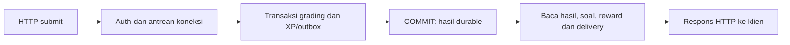

# SIS-001 — investigasi biaya transaksi dan timeout submit

Investigasi 27 Oktober 2026 WIB, role siswa. Sumber: retest C `581a3c97-fe69-40d3-af72-576b22033593`, sesi `7692b45d-adef-4740-acc2-971c65f39b70`. Checkout kandidat: `D:/Dev/Numora-qa-candidate-retest-20261027`, branch `fix/qa-volume-candidate-retest-20261027`, base `598ab47bcba7d79bae9c170b18ee394878397bb5`.

## Kesimpulan berdasarkan bukti

1. **Worker masih membayar biaya satu transaksi dan beberapa round-trip per event.** Query yang memakai indeks tidak menghilangkan biaya BEGIN, SELECT, INSERT, UPDATE, COMMIT dan pemetaan data di aplikasi. Pada antrean 100k, sampel 200 transaksi nyata memerlukan rata-rata **11,40 ms/event**; bagian tunggu commit sekitar **1,88 ms/event**. Commit bukan satu-satunya penyebab backlog.
2. **Jalur submit menunggu sebelum transaksi dan setelah commit.** Pada gelombang langsung 250 submit, p95 waktu klien **14,730 detik**, dekat timeout 15 detik. p95 antrean BEGIN/akuisisi koneksi **8,242 detik**; p95 penyusunan hasil sesudah commit **11,368 detik**. Angka p95 berasal dari distribusi berbeda dan tidak boleh dijumlahkan.
3. **Timeout massal retest B/C belum terulang pada rekonstruksi k6 kali ini.** Beban bertingkat mencatat 1.204 completed dan stress 250 VU 250 completed, error HTTP 0 pada keduanya. Seluruh 1.454 submit yang diakui klien mempunyai hasil GRADED, satu ledger XP, dan satu completion event. Ini bukti investigasi tambahan pada versi yang sama, bukan pengganti hasil full B/C yang FAIL.

Temuan `SIS-001-VOL-RETEST-001` tetap OPEN/BLOCKED; `SIS-001-HTTP-RETEST-002` tetap OPEN dengan reproduksi kondisi spesifik belum konsisten. Kandidat atau perbaikan aplikasi baru belum diterapkan.

## Ruang lingkup dan isolasi

Semua penulisan menuju database tes baru dengan ledger resource dan data sintetis. Tidak ada writer diagnostik menuju database A/B/C. Instrumentasi dipasang lewat wrapper runtime pada proses tes, bukan dengan mengedit source atau build aplikasi. Token tidak direkam; log korelasi hanya berisi ID attempt sintetis, status dan timing. Pool aplikasi tetap **10**, request timeout **15 detik**, tahap k6 **60 detik**, VU **10/25/50/100 lalu 250**, batch worker **10**, batas drain **120 detik**, dan full **3.600 detik**.

Profil worker mengamati 200 event dari setiap antrean fresh berukuran 1k/10k/100k. Ini sampel diagnostik; bukan penyelesaian ulang benchmark volume. Kasus HTTP langsung menyiapkan jawaban dahulu, kemudian melepaskan satu gelombang 10 atau 250 submit. Kasus k6 memakai alur original start → 10 jawaban → submit, dengan tambahan log korelasi pada salinan skrip ignored. Versi asli skrip dan assertion tidak berubah.

Investigasi langsung: `28974b1c-2adf-456a-988a-e6dec4bf3026`. Rekonstruksi k6: `6f074427-90de-449d-97c0-e91c26bec6fd`. Worker memiliki database terpisah untuk setiap ukuran; raw trace, SQL/log HTTP, dan kredensial tetap lokal/ignored.

## Worker: pembagian biaya transaksi

Satuan tabel adalah **rata-rata milidetik per event**. Waktu SQL dari driver mencakup antrean/round-trip dan decode; bukan waktu server SQL saja. BEGIN/akuisisi dihitung sejak permintaan transaksi sampai callback dimulai. Commit ACK mencakup COMMIT dan penyelesaian driver. Sisa callback adalah waktu callback dikurangi tiga query bisnis; termasuk ORM, serialisasi, pemetaan, microtask, dan penjadwalan. Nilai tersebut belum dipisahkan melalui CPU profiler.

| Antrean | Total/event | BEGIN/akuisisi | SELECT | INSERT | UPDATE | Sisa callback | Commit ACK |
| --- | ---: | ---: | ---: | ---: | ---: | ---: | ---: |
| 1,000 | 6.75 | 0.25 | 3.40 | 0.79 | 0.71 | 1.14 | 0.45 |
| 10,000 | 7.15 | 0.44 | 1.62 | 1.18 | 1.11 | 2.05 | 0.71 |
| 100,000 | 11.40 | 0.64 | 2.50 | 1.75 | 1.68 | 2.90 | 1.88 |

Semua sampel: 200 delivered, 200 processed, mismatch 0; tidak ada kegagalan delivery. Wrapper merekam 200 transaksi dan 800 statement per kasus: 200 BEGIN melalui `client.unsafe` serta masing-masing 200 SELECT/INSERT/UPDATE. COMMIT memakai tagged query internal driver dan diukur dari selesainya callback hingga Promise transaksi selesai. Kategori `other` pada trace worker awal adalah BEGIN sesuai implementasi driver lokal; jangan menghitungnya lagi di dalam biaya callback.

EXPLAIN ANALYZE pada query locking exact dijalankan dalam transaksi terpisah lalu ROLLBACK **hanya pada database diagnostik**. Waktu server SELECT setelah sampel: 1k sekitar 2,191 ms, 10k 0,334 ms, 100k 0,825 ms. Ini satu probe per kasus, bukan distribusi waktu SELECT sepanjang benchmark atau durasi commit.

Untuk mengosongkan 100k dalam 120 detik dibutuhkan rata-rata 1,2 ms/event atau sekitar 833 event/detik. Sampel serial 11,4 ms/event menunjukkan anggaran tersebut belum tercapai pada kondisi lokal ini. Jangan mengekstrapolasi sampel menjadi kapasitas produksi atau menjanjikan durasi seluruh antrean. `drainOutboxBatch(10)` tetap melakukan sepuluh transaksi; menaikkan limit tidak menggabungkan COMMIT.

Sumber yang diperiksa: `apps/worker/src/outbox.ts`, `packages/database/src/client.ts`, serta implementasi BEGIN/COMMIT postgres-js 3.4.9 yang terpasang. Query, retry cooldown, SKIP LOCKED dan idempotensi tidak diubah.

## Submit: commit dan respons adalah tahap berbeda

`DrillAssessmentService.submit()` menunggu `db.transaction()`, kemudian memanggil `resultForStudent()`. Fungsi hasil masih melakukan beberapa query: attempt/level/package, hitungan jawaban, ledger reward, baris soal, lalu `record_assessment_delivery`. Karena fase ini terjadi sesudah COMMIT, hasil dapat tersimpan sementara klien masih menunggu atau sudah timeout.

| Gelombang | Respons 201 | Klien p95 (s) | BEGIN/akuisisi p95 (s) | Callback TX p95 (s) | Commit ACK p95 (s) | Penyusunan hasil p95 (s) |
| --- | ---: | ---: | ---: | ---: | ---: | ---: |
| 10 | 10 | 0.780 | 0.017 | 0.444 | 0.012 | 0.220 |
| 250 | 250 | 14.730 | 8.242 | 0.830 | 0.042 | 11.368 |

Kedua gelombang selesai tanpa timeout dan seluruh attempt GRADED memiliki satu ledger serta satu completion event. Retry pada satu attempt per gelombang juga mendapat 201; jumlah ledger/outbox tetap satu. Bukti ini terbatas pada dua retry tersebut, bukan seluruh kombinasi kegagalan jaringan.

Pada trace langsung, SELECT hasil p95 sekitar 8,005 detik; panggilan delivery p95 sekitar 1,287 detik. Angka driver ini mencakup menunggu koneksi dan penjadwalan, bukan bukti query berjalan selama itu di PostgreSQL. Pool tetap 10. Di sampel PostgreSQL interval 200 ms saat gelombang 250, tidak ditemukan `pg_blocking_pids` nonkosong; umur query terbesar yang teramati sekitar 223 ms. Banyak observasi menunggu ClientRead atau idle in transaction; ada sedikit sampel WAL/LWLock. Sampling dapat melewatkan lock singkat dan bukan pengganti tracing setiap statement.

**Interpretasi:** antrean koneksi/BEGIN dan rangkaian query pascacommit merupakan penyumbang keterlambatan yang terukur. Bukti tidak mendukung penjelasan tunggal bahwa fsync COMMIT atau satu lock PostgreSQL yang lama menyebabkan semua timeout. Komponen akuisisi masih mencakup BEGIN, transport dan penjadwalan; pemisahan biaya murni pool versus event loop belum tersedia.

## Rekonstruksi alur k6 dengan korelasi attempt

| Fase | Completed diakui | Error HTTP | Durasi submit p95 (s) | Maksimum submit (s) |
| --- | ---: | ---: | ---: | ---: |
| load | 1204 | 0.00% | 6.277 | 6.530 |
| stress | 250 | 0.00% | 11.462 | 12.133 |

Kolom durasi adalah khusus submit dari log korelasi, bukan seluruh HTTP request campuran. Tidak ada respons submit non-201 pada 1.454 respons yang selesai dicatat. Seluruh ID tersebut cocok dengan GRADED + ledger 1 + completion event 1. Iterasi terinterupsi saat durasi/graceful stop berakhir tetap dipisahkan; bukan semua start yang diterima sudah menyelesaikan Drill. File korelasi tidak menaikkan completed dengan jumlah GRADED dari database.

Kasus gagal lama: B mempunyai timeout start dan stress tanpa completed; C mempunyai 250 submit yang gagal di klien serta hasil GRADED lebih banyak daripada completed. Kasus tersebut tetap ada. Rekonstruksi kali ini tidak mengulang failure massal yang sama, sehingga faktor pemicu persisnya belum terbukti. Kondisi cache, penjadwalan OS, pertumbuhan data, jenis klien, dan overhead wrapper dapat memengaruhi timing. Satu run tiap pola tidak cukup untuk menyatakan kegagalan lama hilang atau menetapkan kapasitas/SLO produksi.

## Rekomendasi developer — PROPOSED, belum diterapkan

1. Worker: evaluasi transaksi batch atau bulk write yang benar-benar mengurangi round-trip per event. Pertahankan SKIP LOCKED, urutan deterministik, retry cooldown, korelasi dan deduplikasi event_id. Uji rollback seluruh/sebagian batch dan event bermasalah; semantik kegagalan harus jelas sebelum mengganti pola per-event. Menambah angka limit saja tidak menyelesaikan biaya transaksi.
2. Submit: kurangi query berulang untuk membentuk respons dari data yang sudah tersedia. Pertahankan pencatatan delivery, otorisasi, histori, formula XP dan idempotensi. Profilkan antrean koneksi serta penjadwalan Node sebelum memilih perubahan pool/admission; jangan menaikkan pool secara membabi buta atau memperpanjang timeout untuk membuat hasil hijau.
3. Pertahankan korelasi attempt ID dan pemisahan committed/response-finished pada retest berikutnya. Nilai hasil klien dan durabilitas database secara terpisah. Retest perbaikan per kandidat dengan parameter yang sama dan bukti kegagalan sebelumnya tetap tersedia.

Satu langkah berikutnya yang direkomendasikan: siapkan kandidat optimasi worker dan pembentukan respons submit sebagai artefak review, beserta regresi yang dibutuhkan. Penerapan pada source aplikasi, merge/push/deploy dan publikasi tidak dilakukan pada investigasi ini.

## Status dan verifikasi

Kode source/build aplikasi dan konfigurasi eksperimen tidak diubah. Hash result A/B/C tetap sama dengan ekspor sebelumnya. Semua hook pengamat hanya hidup pada proses tes yang sudah dihentikan; tidak ada proses API/runner investigasi yang masih aktif. Layanan PostgreSQL/Redis lokal dipertahankan. Full B/C tetap FAIL, volume/stress BLOCKED, dependency FAIL dan manual NOT_RUN; bukti tambahan ini tidak mengubah status itu.

Alat diagnostik sempat diperbaiki: serialisasi fixture JSON harus melalui text→jsonb; preload Windows memerlukan file URL; inherited DATABASE_URL dipulihkan agar guard normal tetap dijalankan; scope variabel controller diperbaiki. Percobaan gagal dicatat sebagai masalah tooling dan dipertahankan. Worker profile yang sudah sukses tidak diulang saat melanjutkan HTTP. Tidak ada guard isolasi yang dinonaktifkan dan tidak ada assertion aplikasi yang dilonggarkan.

Ringkasan terstruktur dan korelasi tersanitasi tersedia di `SIS_001_TRANSACTION_TIMEOUT_INVESTIGATION.json`; trace mentah berada pada direktori investigasi ignored. Paket laporan mencantumkan hash source, identitas resource dan batas kesimpulan. Ini investigasi lokal dengan auth fixture sintetis, bukan pengujian Google login, staging atau produksi.
